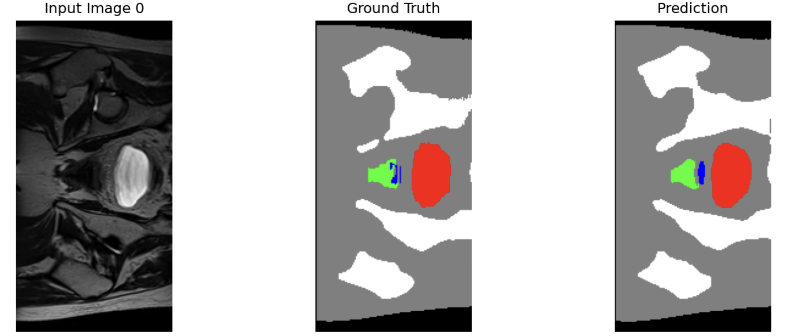
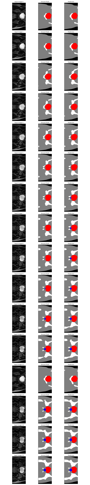
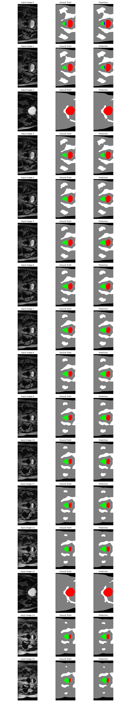
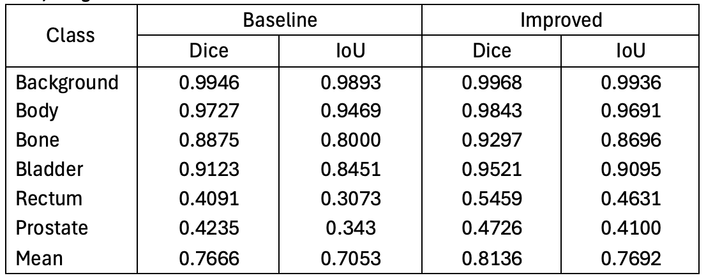
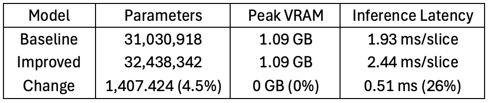
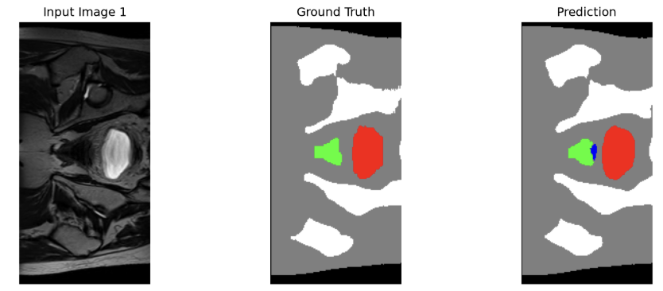
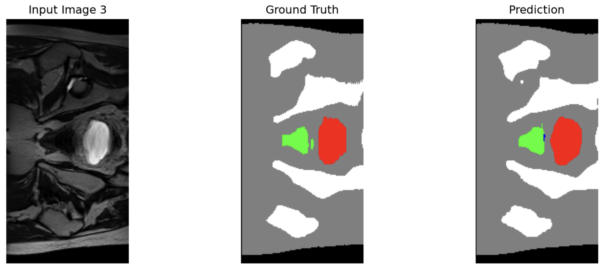
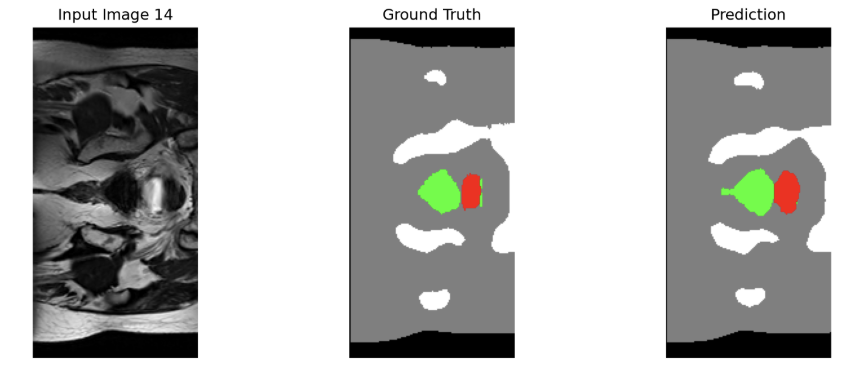

# Analysis of 2D U-Net Architecture for Prostate Segmentation in MRI

## Description of Algorithm and Problem 
2D U-Net is a symmetric neural network used for image segmentation to divide an image into different parts to identify them into specific classes. It is widely used in medical imaging as it achieves strong performance on small annotated datasets (Ronneberger et al., 2015). This project specifically seeks to automate the contoring of the prostate and the surrounding organs at risk from 2D MRI slices for radiotherapy cancer planning. 

The model was trained on the HipMRI 2D slices (keras_slices_data) and takes a single-channel grayscale MRI slice as input and outputs a 6 channel probability map, assigning each pixel to one of six classes: background, body, bone, bladder, rectum or prostate. 

Two architectures were implemented: a baseline 2D U-Net model and an improved 2D U-net model. The baseline was based on Ronneberger et al's (2015) paper, which consisted of a model with a contracting encoder path and a symmetric expansive decoder path. The improved architecture was based on Isensee et al which replaces the standard convolution blocks with residual blocks containing identity skip connections. The paper uses instance normalisation for small batch training, but my model uses batch normalisation as the Rangpur A100 hardware that it was trained on supports a batch size of 16, where it would then provide highly stable gradient flow. Deviating from the paper, both models use padding=1 to allow direct concatenation of skip connections without cropping, making the output the same spatial size as the input. 



Figure 1: Example of model prediction. Left: Normalised input MRI. Middle: Ground truth segmentation mask. Right: Model prediction. Colours: Background (black), Body (grey), Bone (white), Bladder (red), Rectum (green), Prostate (blue).


## Feasibility Review
**User Need, Scope and Acceptance Criteria**
The intended user of this prototype are radiation oncologists preparing for a prostate cancer radiotherapy plan, who currently have to manually contour each of the prostate clinical target volumes while sparing critical organs at risk. The purpose of this prototype would be to act as an assistant alongside professional human judgment to streamline radiation planning. It would propose a prostate contour on each 2D slice that a radiation oncologist or specialist could then review and edit before the plan is finalised. 

Acceptance criteria addressing domain’s open dilemma:
1.	Target Dice for prostate labels on test set should aim to be greater than or equal to 0.75. High Dice would be necessary in clinical use cases. 
2.	Peak VRAM should be under 16 GB to ensure the model remains deployable on commercial clinical workstation GPU’s rather than requiring expensive hardware.
3.	Ronneberger et al (2015) states that segmentation on 2D U-Net architecture is fast and takes less than a second for a 512 x 512 image. Hence, this model should also aim for an Inference latency of less than 100ms for each slice, which would make it effective for clinical use. 

**Model choice and Course Concepts**
The model architecture that will be used is the Standard 2D U-Net (Ronneberger et al., 2015). It uses an encoder to extract complex features from the input image and then a decoder to reconstructs the spatial detail from the compressed feature representations. Skip connections transfer high-resolution feature maps directly from the encoder to the decoder stages. The final layer is 1x1 mapping each pixel’s feature vector to 6 output classes. 

The project aims for a medium complexity, where the main focus is to construct a baseline 2D U-Net model first and then improve upon it by replacing the standard convolution blocks with residual blocks and adding batch normalisation per Isensee et al’s (2017) paper to build an improved U-Net architecture. 

**Preliminary Feasibility Evidence**
Data processing pipeline was completed where all 11,460 training images were paired successfully with their label files. Class frequences was measured for every 10th sample: background (17.48%), body (67%), bone (12.85%), bladder (1.83%), rectum (0.37%), and prostate (0.47%). There is a severe class imbalance with the prostate target class being only 0.47% of the dataset.  Most of the training slices are 256x128 with the remaining 60 being 256x144. Training set contains patients from 004-035, validation contains from 036-039 and test contains from 040-042, where no patient appears in more than one set, preventing data leakage. A 1-epoch smoke test was run confirming that the data pipeline, model and training loop works, where the baseline model converged to prostate Dice 0.19.

**Risks, Budget and Fallback**
Risks could include delays on Rangpur, where allocating resources might take longer than expected. Training the model should take precedence before any of the documentation. The smoke test took around 80 seconds for 1 epoch so running 50 epochs would take around an hour to complete. The improved model should take a similar amount of time with an estimate total of 2-3 hours of GPU computing time. 

The next planned experiment is to train the baseline for 50 epochs and then the improved model for 50 epochs on the same split. I’ll evaluate Dice and IoU scores on the test set and return prediction overlay images to look for failure cases. If the improved model implementation fails, I’d look to comparing the baseline model with another easy implementation such as the 2D CAN to secure at least the 5/20 marks.


## Dependencies and Reproducibility
All models were trained and executed on the Rangpur HPC Cluster. The library version used were:
python: 3.11
torch: 2.14.1+cu130
torchvision: 0.29.1+cu130
nibabel: 5.4.2
numpy: 2.4.6
matplotlib: 3.11.2
tqdm: 4.70.1


### Reproducibility Instructions
To reproduce the results from a fresh clone of this repository on Rangpur:

1. **Clone and setup:**
   ```bash
   git clone <fork-url>
   cd PatternAnalysis-2026/recognition/UNet2D_s4883210
   conda create -n torch python=3.11 -y
   conda activate torch
   pip install torch torchvision nibabel numpy matplotlib tqdm

2. Train baseline model:
python train.py --model unet2d --epochs 50 --batch-size 16 --out-dir ./runs/unet2d_baseline

3. Train improved model:
python train.py --model improved_unet2d --epochs 50 --batch-size 16 --out-dir ./runs/improved_unet2d

4. Evaluate both models on test set
python evaluate.py --model unet2d --weights ./runs/unet2d_baseline/best.pt --out-json ./runs/eval_baseline.json
python evaluate.py --model improved_unet2d --weights ./runs/improved_unet2d/best.pt --out-json ./runs/eval_improved.json

5. Generate prediciion visualisations
python predict.py --weights ./runs/improved_unet2d/best.pt --out-dir ./predictions


## Example inputs, outputs, and visual plots of algorithm 
Input - tensor of shape (B, 1, 256, 128) where B is the batch size (16 during training, 4 during inference). 1 is the grascale channel, and 256x128 is the spatial resolution of the MRI slice.
Output - tensor of shape (B, 6, 256, 128) where 6 represents the logits for the 6 classes (body, background, bone, bladder, rectum, prostate).

 
Figure 2: Example of test-set inference from Baseline 2D U-Net. Left: Normalised input MRI. Middle: Ground truth segmentation mask. Right: Model prediction. Colours: Background (black), Body (grey), Bone (white), Bladder (red), Rectum (green), Prostate (blue). Contains 16 slices. 



Figure 3: Example of test-set inference from Improved 2D U-Net. Contains 16 slices. 


## Preprocessing 
Most HipMRI slices were 256x128, but a small subset were stored as 256x144. Every slice was resized to 256x128 to preserve 100% of the training data as tensors of different spatial sizes cannot be stacked into a single batch. For the images, bilinear interpolation was used to preserve intensity gradients while for the label masks, nearest neighbour interpolation was used to preserve the integer class IDs.

Ground truth masks were stored as single channel integer images with class values 0-5. The output was fixed to 6 channels, one hot encoding every pixel into the correct class regardless of which classes are present in that slice. 

Z-score normalisation was applied per slice, which centred each slice to zero mean and unit variance, stabilising batch normalisation layers in the improved model, leading to better convergence. 

The data set was already split into training, validation and test sets. Training set contained patients from 004-035 with 11,460 slices, validation set has patients 036-039 with 660 slices, and test set has patients 040-042 with 540 slices. No patients appeared more than once, ensuring that there was no data leakage in between the different sets which could have led to the model to innacurately memorise information.


## Investigation of the Open Research Dilemna
### Quantitative benchmark

Figure 6: Comparison of Dice and IoU scores between baseline and improved 2D U-Net models.

The improved U-Net performed better than the baseline on all six classes for Dice and IoU scores. Most noticably, it performed significantly better for the minority classes where the improved U-Net increased Dice from 0.4091 to 0.5459 for rectum (33.4%) and 0.4235 to 0.4726 (11.6%) for prostate. The improved U-Net improved IoU from 0.3073 to 0.4631 for rectum (50.7%) and 0.3430 to 0.4100 for prostate (19.5%). This suggests that the residual blocks and batch normalsiation help the network to resolve the thin anatomical boundary between the rectum and surrounding tissue that the baseline struggles with. 

Both models scored high Dice and IoU for the body, bone and bladder classes (>0.8) but struggled with the rectum and prostate classes with Dice scores being <0.55. 

### Resource profiling

Figure 7: Comparison of peak GPU VRAM, parameter count, and inference runtime/latency between baseline and improved. 

Both models are efficient and extremlely computationally lightweight with a peak of 1.09GB VRAM at only 1.93ms per slice for the baseline and 2.44ms/slice for the improved model. The models would then be easily deployable on any modern GPU and be fast enough for clinical use. 

### Qualitative error autopsies on improved model

Figure 8: False Positive Case 1


Figure 9: False Positive Case 2


Figure 10: Boundary Case

Figure 8 and 9 show false positive cases in which the ground truth does not have any blue pixels (prostate), while the model incorrectly predicted it. The model may have learned a strong prior where the prostate appears near the bladder from training slices where both strutures exist, leading the model to produce false prediction of prostate pixels. False positives are harmful in radiotherapy as, if the prediction is not fully reviewed, it could cause the treatment plan to include non-target tissue in the high-dose region, delivering unintended radiation to healthy muscle.

The ground truth in Figure 10 shows a slight green region (rectum) to the right of the bladder while the prediction only contains a barely visible green dot, missing the majority of the true rectum. This is likely driven by the rectum being the second rarest class at 0.37%, and it's close promximity to the prostate. The model may have learned to under predict the rectum to minimise the overall weighted loss where missing a few pixels is less costly than the many false positives it would generate by over predicting.

The model fails at the thin boundary between soft-tissue structures such as the prostate and rectum. The baseline model also exhibited similar fail cases with a higher Dice penalty. This is attributed to the small structure size of the prostate and the absence of 3D context, where a 2D slice cannot properly segment the boundaries.

### Engineering recommendation
The improved model does not reach the target Dice of 0.75 on prostate labels and exhibits potentially harmful failure modes with false-positive prostate predictions and rectum under-segmentation. Therefore, it should not be deployed for autonomous clinical use.

The improved model has 4.5% more parameters and 26% more inference time than the baseline 2D U-Net architecture but improves mean Dice by 6.13%, prostate Dice by 11.6% and rectum Dice by 33.4%. This is a good trade off as the peak VRAM usage does not change and the inference time only increases by 0.51 ms/slice, which is negligible for real world clinical applications.

The model does have favourable Dice scores for body, bone and bladder classes. It could act as an assisstant that annotates and automatically generate contours for these classes, where a healthcare professional could then easily check over and verify. The model does not offer high accuracy for prostate and rectum predictions and they should therefore be left to the professionals for manual review. 


## Artifical Intelligence Usage Disclosure
### AI Tools used
**Deepseek**
- Generating scripts for dataset auditing such as counting class frequencies and verifying patient-level splits
- Generating matplotlib plotting close for visualisation of training curves and prediction overlays
- Assissting with train.py and evaluate.py output for outputting statments for metric logs
- Explaining the strucutre of the pre-supplied load_data_2D function in assignment appendix
- Drafting the dependencies and reproduciblity section of README

**Gemini**
- Used for looking up, researching and clarifying concepts

### Verification
AI for generating plots or formatting was used with knowledge of what each line does and what it would output. AI used for explaining code and concepts was double checked with non AI sources (e.g, PyTorch/torchvision documentation, lecture notes, papers, etc). Before commiting to submitting any training jobs, 1 epoch smoke tests were first run to check for any potential bugs and to ensure that the output matched what I had intended.


## References
Isensee, F., Kickingereder, P., Wick, W., Bendszus, M., & Maier-Hein, K. H. (2017, September). Brain tumor segmentation and radiomics survival prediction: Contribution to the brats 2017 challenge. In International MICCAI brainlesion workshop (pp. 287-297). Cham: Springer International Publishing.

PyTorch Contributors. (2023). Module. Pytorch.Org. https://docs.pytorch.org/docs/stable/generated/torch.nn.Module.html

Ronneberger, O., Fischer, P., & Brox, T. (2015, May 18). U-net: Convolutional networks for biomedical image segmentation. arXiv.Org. https://arxiv.org/abs/1505.04597

Tomasz Kalinowski, Daniel Falbel, Posit Software, PBC. (n.d.). Resize a dataset item — Item_transform_resize. Torchvision. Retrieved November 1, 2026, from https://torchvision.mlverse.org/reference/item_transform_resize